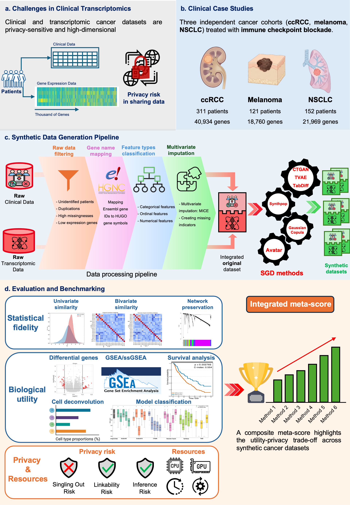
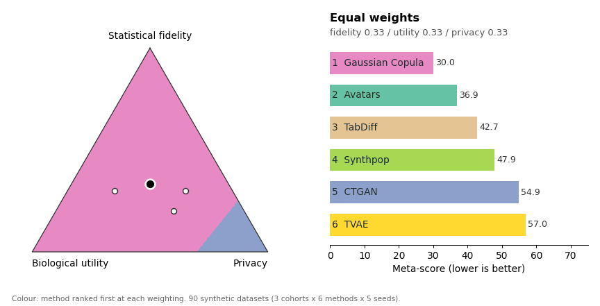

# SynOmicsBench

[](https://zenodo.org/records/19660703)
[](https://github.com/trinhthechuong/SynOmicsBench/actions/workflows/ci.yml)
[](https://trinhthechuong.github.io/SynOmicsBench/)
[](https://pypi.org/project/synomicsbench/)
[](https://opensource.org/licenses/MIT)
[](https://www.python.org/downloads/release/python-3120/)
[](https://github.com/astral-sh/ruff)
[](https://github.com/astral-sh/uv)
[](https://github.com/trinhthechuong/SynOmicsBench/pkgs/container/synomicsbench)


**SynOmicsBench** is a unified benchmarking framework for synthetic data generation (SDG) for clinical trial transcriptomic cancer cohorts.

Achieving a trade-off between **biological utility** and **patient privacy** is critical for secure data sharing when applying transcriptomic clinical trial datasets to artificial intelligence in precision oncology. Here, we present the **SynOmicsBench** framework. SynOmicsBench combines standardized preprocessing with multidimensional evaluation, prioritizing downstream biological validation alongside statistical fidelity and attack-based privacy assessment. This work provides a reproducible decision-support tool for method selection and promotes biologically informed, privacy-aware adoption of synthetic data in precision oncology.

---

## 🔬 Framework Overview



SynOmicsBench compares synthetic data generation methods using a standardized pipeline that combines:

- **Standardized Preprocessing**: Automated data filtering, harmonization, and integration.
- **Multidimensional Evaluation**: Assessing Statistical Fidelity (including co-expression network preservation), Downstream Biological Utility (F1 concordance, effect-size calibration, survival score with C-index confidence intervals), and Privacy Risk (with an external control cohort), combined into a twelve-metric meta-score by a one-call automatic benchmark. See [What's new in 1.2.0](https://trinhthechuong.github.io/SynOmicsBench/whats-new/).
- **State-of-the-Art SDG Methods**: Native support for **CTGAN, TVAE, Gaussian Copula, Synthpop, TabDiff, and Avatars**. 

---

## 🏆 Overall ranking

Six SDG methods, 90 synthetic datasets (ccRCC, Melanoma and NSCLC cohorts × 6 methods × 5 seeds) and twelve metrics in three pillars: statistical fidelity, biological utility and privacy. On every metric the 90 datasets are ranked together; a method's meta-score is the weighted sum of its three pillar scores (mean ranks; lower is better).

The right weights depend on how the synthetic data will be shared:

- **Equal weights** (statistical fidelity / biological utility / privacy: 1/3 each).
- **Controlled sharing within a research consortium** (0.3 / 0.5 / 0.2): access is governed by a data transfer agreement, so the legal framework carries most of the privacy burden; biological utility comes first, as the goal is faithful downstream discovery.
- **Public release for open challenges or hackathons** (0.2 / 0.3 / 0.5): no governance layer restricts access, so privacy weighs most; biological utility comes second, so that models trained on the data generalize to real patients.
- **Method development and pipeline testing** (0.3 / 0.2 / 0.5): synthetic data embedded in software packages, tutorials and public repositories, so privacy weighs most; statistical fidelity comes second, as the software must behave as it would on real data.

Rank (meta-score) of each method:

| Method | Equal weights | Controlled sharing within a research consortium | Public release for open challenges or hackathons | Method development and pipeline testing | Ranked first over all weights |
|---|---|---|---|---|---|
| Gaussian Copula | 1 (30.00) | 1 (27.14) | 1 (33.84) | 1 (33.69) | 92.12% |
| Avatars | 2 (36.94) | 2 (35.01) | 2 (41.14) | 2 (40.12) | 0.00% |
| TabDiff | 3 (42.74) | 3 (40.70) | 3 (44.05) | 3 (44.76) | 0.00% |
| Synthpop | 4 (47.88) | 4 (47.03) | 5 (51.01) | 5 (49.83) | 0.00% |
| CTGAN | 5 (54.86) | 6 (59.30) | 4 (47.61) | 4 (48.58) | 7.88% |
| TVAE | 6 (56.97) | 5 (59.12) | 6 (51.65) | 6 (53.15) | 0.00% |

### Sensitivity to the pillar weights

Each point of the triangle is a weighting of the three pillars, coloured by the method ranked first; the ranking on the right follows the point through the four weightings. Click the animation to open the interactive report.

[](https://trinhthechuong.github.io/SynOmicsBench/assets/reports/synomicsbench_leaderboard.html)

**[Open the full interactive report](https://trinhthechuong.github.io/SynOmicsBench/assets/reports/synomicsbench_leaderboard.html)** · [Benchmark Leaderboard](https://trinhthechuong.github.io/SynOmicsBench/evaluation/leaderboard/)

---

## 🛠 Installation

SynOmicsBench can be installed in three different ways depending on your environment. **Python 3.12+** is required.

### Option 1: From PyPI (Recommended)

```bash
pip install synomicsbench
```

### Option 2: From Source (GitHub)
We recommend using [`uv`](https://docs.astral.sh/uv/) for fast, reliable dependency management. This method uses the provided uv.lock file to ensure reproducible installations.
```bash
git clone https://github.com/trinhthechuong/SynOmicsBench.git
cd SynOmicsBench

# With uv (Fastest)
uv sync
source .venv/bin/activate

# Or with traditional pip
pip install -e .
```

### Option 3: Pre-built Container (Apptainer/Singularity)
For HPC environments or reproducible workflows, you can pull our fully prepared Apptainer container which contains all dependencies (including heavy ML frameworks and R):

```bash
# Pull the latest SynOmicsBench container
apptainer pull synomicsbench.sif oras://ghcr.io/trinhthechuong/synomicsbench:latest

# Verify the container is working and the package is ready
apptainer exec synomicsbench.sif python -c "import synomicsbench; print('OK: SynOmicsBench is ready!')"
```
*(To use the container for your scripts, simply mount your directories via `--bind` and run your Python scripts using `apptainer exec`)*

---

## 🚀 Quick Start

Here is a minimal end-to-end example: preprocess data, generate synthetic samples with Gaussian Copula, and evaluate statistical fidelity.

```python
import pandas as pd
from synomicsbench.processing.preprocessing import DataProcessor
from synomicsbench.processing.metadata import MetaData
from synomicsbench.synthesizer.GaussianCopulasynthesizer import GaussianCopulasynthesizer
from synomicsbench.metrics.fidelity.UnivariateSimilarity import UnivariateSimilarity

# ── 1. Load & preprocess ──────────────────────────────────────────────────────
original_data = pd.read_csv("your_clinical_transcriptomic_data.csv")

original_data = DataProcessor.remove_unknown_entities(original_data, id_column="Patient_ID")
original_data = DataProcessor.remove_duplications(original_data, axis=0).reset_index(drop=True)
original_data = DataProcessor.mice_imputation(original_data, iterations=10, n_estimators=100)

# ── 2. Build metadata ─────────────────────────────────────────────────────────
ordinal_features = ["Mstage", "Tx_Start_ECOG", "numPriorTherapies"]
metadata = MetaData.get_metadata(
    data=original_data,
    ordinal_features=ordinal_features,
    threshold_unique_values=10,
)

# ── 3. Generate synthetic data ────────────────────────────────────────────────
synth = GaussianCopulasynthesizer(output_path="./results", metadata=metadata)
synthetic_data = synth.generate(
    data=original_data,
    seed=42,
    n_samples=original_data.shape[0],
    output_filename="synthetic_data.csv",
)

# ── 4. Evaluate statistical fidelity ─────────────────────────────────────────
evaluator = UnivariateSimilarity(output_dir="./results/evaluation")
score = evaluator.get_univariate_score(
    original_data=original_data,
    synthetic_data=synthetic_data,
    metadata=metadata,
    save=True,
)
print(f"Univariate Fidelity Score: {score:.4f}")
```

---

## 📚 Documentation

For complete API references, tutorials, and full benchmarking results, check out the **[SynOmicsBench Official Documentation](https://trinhthechuong.github.io/SynOmicsBench/)**:

- [**Getting Started**](https://trinhthechuong.github.io/SynOmicsBench/getting-started/): Step-by-step setup guides.
- [**Preprocessing Pipeline**](https://trinhthechuong.github.io/SynOmicsBench/preprocessing/): Harmonizing multimodal data.
- [**SDG Methods**](https://trinhthechuong.github.io/SynOmicsBench/synthetic-data/): Deep dive into generation models.
- [**Evaluation Framework**](https://trinhthechuong.github.io/SynOmicsBench/evaluation/): Understand our metrics for Privacy and Biological signal preservation.

---

## 📄 License
This project is open-sourced under the MIT License.
