# Biological Rediscovery Results

Beyond metric-based evaluation, we re-implemented the analytical workflows described in the original clinical studies to determine whether established biomarkers and biological insights could be independently rediscovered from synthetic data. This page presents the findings of the revised SynOmicsBench benchmark, organized by cancer cohort and following the narrative of each original study. Six SDG methods are compared: Avatars, CTGAN, Gaussian Copula, Synthpop, TVAE and TabDiff, each with five replicates (random seeds 0, 1, 2, 3 and 42).

  <!-- ccRCC -->
  <a href="#ccrcc" class="sdg-card">
    

      
      <h3>ccRCC</h3>
    

  </a>

  <!-- Melanoma -->
  <a href="#melanoma" class="sdg-card">
    

      
      <h3>Melanoma</h3>
    

  </a>

  <!-- NSCLC -->
  <a href="#nsclc" class="sdg-card">
    

      
      <h3>NSCLC</h3>
    

  </a>

---

## Effect sizes across the three cohorts

The differentially expressed genes (DEGs) between responders and non-responders number 1,349 in ccRCC, 1,415 in Melanoma and 1,018 in NSCLC (*P* < 0.05). Comparing the synthetic with the original Log2FC of these genes shows that effect directions are largely preserved but their magnitudes are attenuated. For **Gaussian Copula**, 84–92% of the original DEGs keep the sign of their Log2FC and the synthetic and original effect sizes are strongly correlated (Pearson's *r* = 0.62–0.81), but calibration slopes of 0.56–0.76 mean that synthetic effects are on average 24–44% smaller, so most DEGs no longer reach *P* < 0.05. Avatars keeps 67–75% of the signs with slopes of only 0.16–0.21, TVAE 65–69% with slopes of 0.39–0.46, and TabDiff 66–81% with slopes of 0.30–0.71. CTGAN and Synthpop do not preserve effect direction (sign concordance 47–56%, slopes and Pearson's *r* close to zero): the signal is lost rather than attenuated.

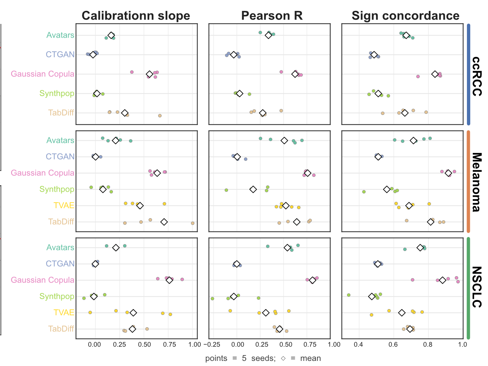
***Figure 1**: Calibration slope (ordinary least squares), Pearson r and sign concordance of the synthetic versus original Log2FC of the original DEGs in the three cohorts. Each point is one replicate; diamonds are the means.*

At the pathway level, concordance is harder to achieve and no method performs consistently best. Pathway effect sizes (NES) are also attenuated, with most calibration slopes below 1, and some replicates show negative slopes or correlations, a reversal of the original pathway signal. All metrics vary more between replicates at the pathway level than at the gene level.

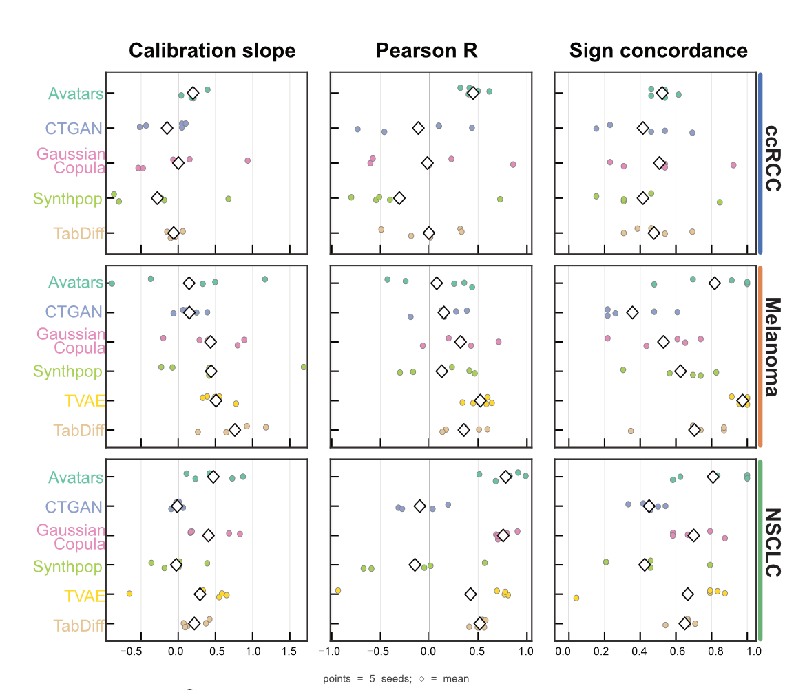
***Figure 2**: Theil–Sen calibration slope, Pearson r and sign concordance of the NES of the Hallmark pathways significant in the original data, in the three cohorts. Each point is one replicate; diamonds are the means.*

---

## ccRCC

**Cohort**: 311 patients with advanced clear cell renal cell carcinoma from the CheckMate 009, 010 and 025 trials, treated with nivolumab (anti-PD-1). Original study by [Braun et al. (*Nature Medicine*, 2020)](https://doi.org/10.1038/s41591-020-0839-y).

Braun et al. performed an integrated genetic, transcriptomic, and immunopathologic analysis of advanced ccRCC tumors, uncovering how somatic alterations, particularly PBRM1 mutations and 9p21.3 deletions, interact with immune infiltration patterns to modulate response to PD-1 blockade.

### Differential Gene Expression

The higher angiogenesis score associated with PBRM1 mutation (*P* < 0.01) was reproduced by **Avatars**, **Gaussian Copula** and, more weakly, **TabDiff**, but not by the other SDG methods (**Figure 3**).

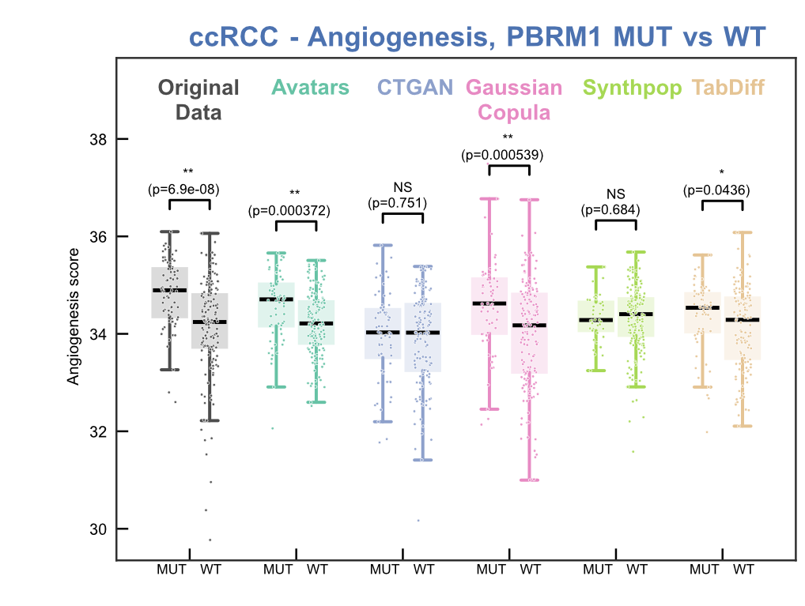
***Figure 3**: Angiogenesis score in PBRM1-mutant versus wild-type ccRCC tumors, in the original data and one replicate of each SDG method. Two-sided Wilcoxon rank-sum test.*

### Gene Set Enrichment Analysis

In the original study, **9p21.3 deletion** was associated with increased EMT, mTORC1 signaling, angiogenesis, hypoxia and glycolysis, and with decreased oxidative phosphorylation, fatty acid metabolism and TGF-β signaling. **Avatars** and **Gaussian Copula** reproducibly recapitulated the down-regulated pathways (fatty acid metabolism and oxidative phosphorylation, in all five replicates), whereas up-regulated pathways were less consistently preserved across replicates (**Figure 4**).

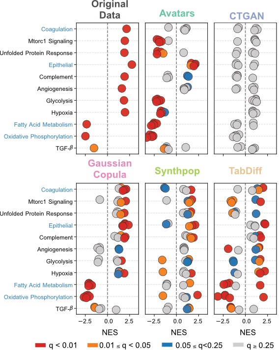{ width="560" }

***Figure 4**: GSEA of 9p21.3 deletion in the ccRCC cohort. NES of the Hallmark pathways in the original data and in the five replicates of each SDG method (one point per replicate); colors indicate the FDR q-value.*

### Single-sample GSEA

Gaussian Copula achieved the highest KS-Complement scores of the ssGSEA NES distributions in all cohorts, followed by TabDiff in ccRCC and Melanoma. The PBRM1-associated reduction of **IL6-JAK-STAT3 signaling**, together with the estrogen response, apoptosis, allograft rejection and UV response pathways, was robustly reproduced by **Gaussian Copula**, by **TabDiff**, which inflated their effect sizes, and to a lesser extent by **Avatars**, which preserved their direction but rarely their significance. The other methods showed pronounced inter-replicate variability (**Figure 5**).

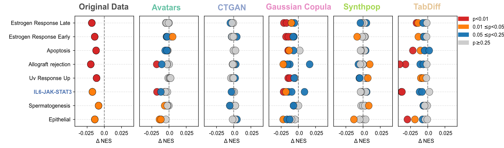
***Figure 5**: Association between ssGSEA signals and the PBRM1 phenotype in ccRCC. Bubble plots compare the differential NES between PBRM1-mutant and wild-type patients in the original data and the five replicates of each SDG method; colors denote P-value thresholds (Wilcoxon rank-sum test).*

### Cell Type Deconvolution

Immune cell composition was inferred with CIBERSORTx and the LM22 signatures. Concordance with the original data, measured by the Aitchison distance, was highest in ccRCC. **Avatars** and **Gaussian Copula** reconstructed the immune contrasts between infiltrated and excluded/desert tumors, including CD8 T cells and resting memory CD4 T cells. This recovery was reproducible at a relaxed significance level (Wilcoxon rank-sum test, FDR *Q* < 0.25) and confined to cell types with robust signals in the original data. **TabDiff** recovered the CD8 T cell contrast in only two replicates, while CTGAN and Synthpop recovered none (**Figure 6**).

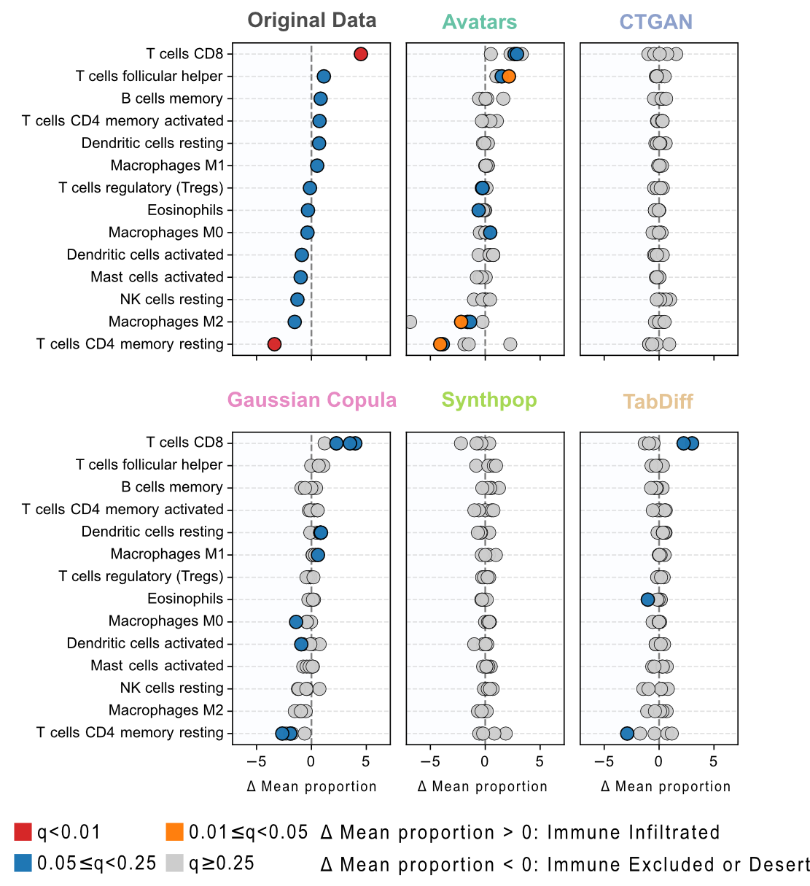{ width="620" }

***Figure 6**: Differential LM22 immune cell proportions between immune-infiltrated and immune-excluded/desert tumors in ccRCC, original data and five replicates of each SDG method. Colors indicate significance (two-sided Wilcoxon rank-sum test, FDR-adjusted).*

### Survival Analysis

Braun et al. showed that patients with **PBRM1 alterations had improved overall survival** (*P* < 0.05). Recovering such biomarker stratifications proved more demanding and method-dependent than preserving the global survival association between response and outcome. Gaussian Copula and TabDiff were the only two methods to achieve significant patient classification in the three biomarker analyses of the benchmark (one per cohort), albeit with low robustness across replicates. TVAE generated no patient with clinical benefit in any ccRCC replicate (**Figure 7**).

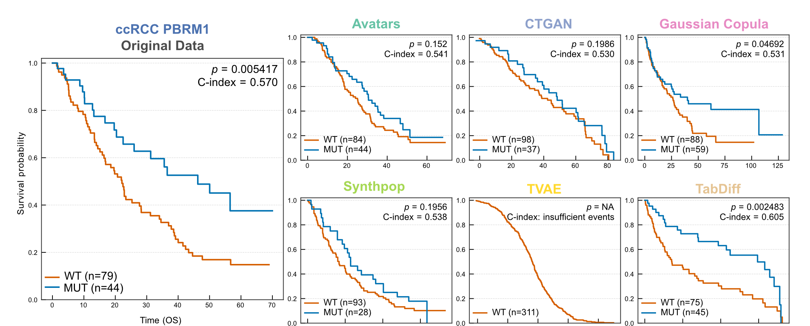
***Figure 7**: PBRM1-associated overall survival in ccRCC. Kaplan-Meier curves of PBRM1-mutant (blue) and wild-type (orange) patients in the original data and in the best recapitulated replicate of each SDG method, with log-rank P-values and C-indices.*

---

## Melanoma

**Cohort**: 121 patients with metastatic melanoma treated with anti-PD-1 immune checkpoint blockade. Original study by [Liu et al. (*Nature Medicine*, 2019)](https://doi.org/10.1038/s41591-019-0654-5).

Liu et al. performed an integrative molecular analysis, discovering that MHC class II-associated gene expression, interferon response pathways, and immune cell composition were key determinants of anti-PD-1 response, and developed parsimonious predictive models integrating clinical, genomic and transcriptomic features.

### Feature correlation structure

Following Liu et al., the correlation matrices of the Melanoma features were clustered hierarchically. The original data show immune-related clusters with MHC class I and II substructures, a separate cluster of mutation and neoantigen load features, and a negative association between tumor purity and immune infiltration. **Avatars** and **Gaussian Copula** largely recapitulated these structures, followed by **Synthpop**, which preserved the MHC clusters but lost the mutation and neoantigen load cluster in all replicates, whereas CTGAN and TVAE produced noisier or overly smoothed patterns. **TabDiff** reproduced the overall correlation pattern in four of five replicates, with attenuated MHC and mutation and neoantigen load clusters (**Figure 8**).

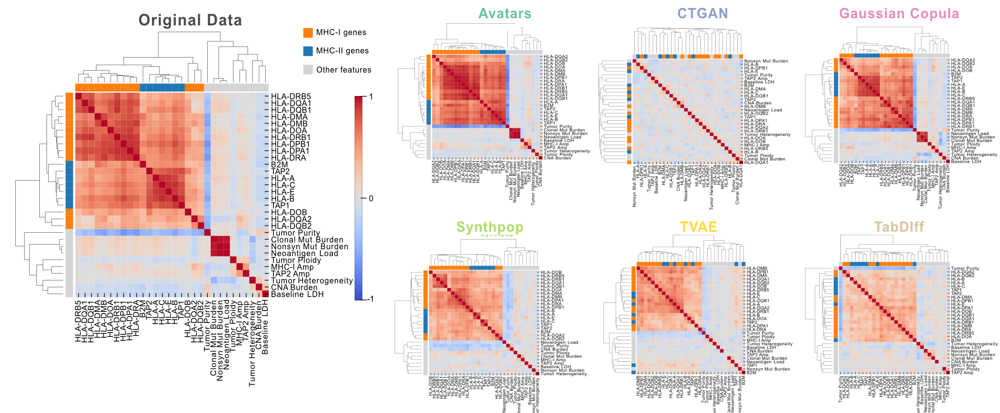
***Figure 8**: Hierarchical clustering of the feature correlation matrices of the Melanoma cohort, original data and one replicate of each SDG method.*

### Differential Gene Expression

MHC class I and II (HLA) genes are up-regulated in responders. **Gaussian Copula**, **Avatars** and **TVAE** reproduced the correct direction for most of these genes, albeit with attenuated fold changes (**Figure 9**), consistent with their calibration slopes and sign concordance (**Figure 10**).

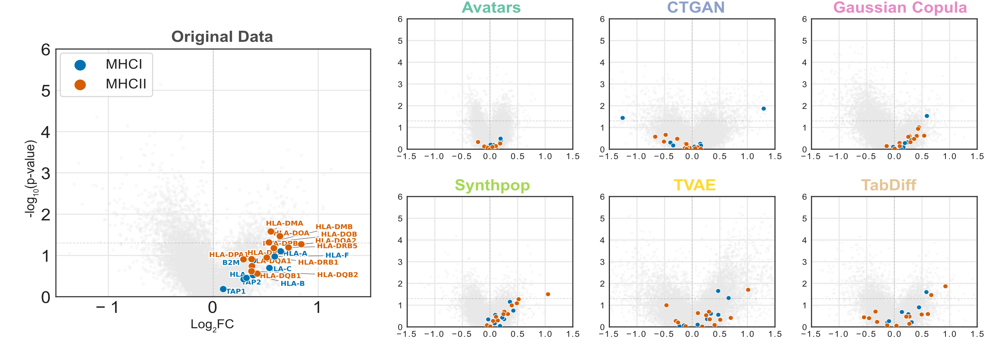
***Figure 9**: Volcano plots of responders versus non-responders in Melanoma; highlighted points are MHC class I and MHC class II HLA genes, up-regulated in responders in the original data.*

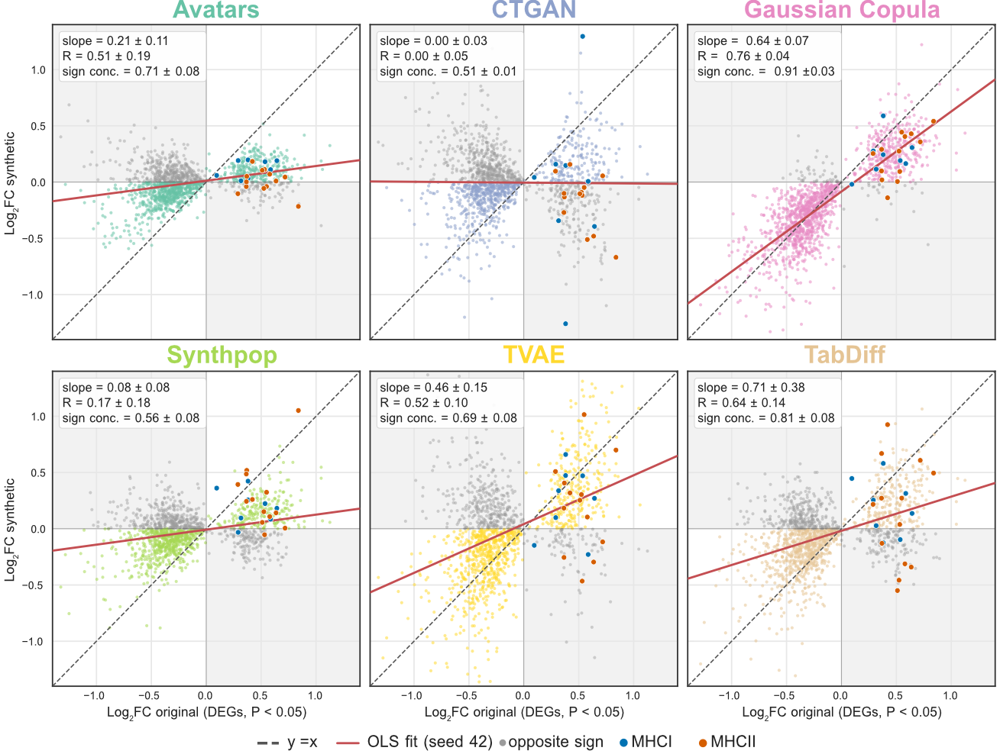
***Figure 10**: Effect-size calibration in Melanoma: synthetic versus original Log2FC of the genes differentially expressed in the original data (P < 0.05). Dashed line, y = x; red line, ordinary least-squares fit (replicate 42); grey points, genes with the opposite sign; blue and orange points, MHC class I and class II genes. Insets give the calibration slope, Pearson R and sign concordance as mean ± SD over five replicates.*

### Gene Set Enrichment Analysis

Immune-related pathways (IFN-γ response, allograft rejection, complement, inflammatory response and IL6-JAK-STAT3 signaling) enriched in responders were broadly recovered by most methods except CTGAN, with **TVAE** the most reproducible; reproducibility across replicates varied substantially for the other methods (**Figure 11**).

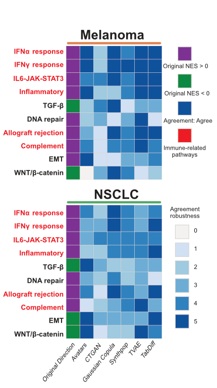{ width="360" }

***Figure 11**: Immune-related pathways in Melanoma and NSCLC. For each pathway, the original direction of enrichment and the number of replicates (0–5) in which each SDG method reproduced it.*

Liu et al. further reported a significant enrichment of the **IFN-γ** and **IFN-α** response pathways in ipilimumab-treated responders, which was absent in ipilimumab-naive patients. This treatment-stratified pattern was robustly reproduced by **Gaussian Copula** in three of five replicates, and partially by Avatars, Synthpop and TabDiff (**Figure 12**). Single-run assessments can therefore overestimate synthetic data quality: reproducibility across random seeds is essential for reliable biological inference.

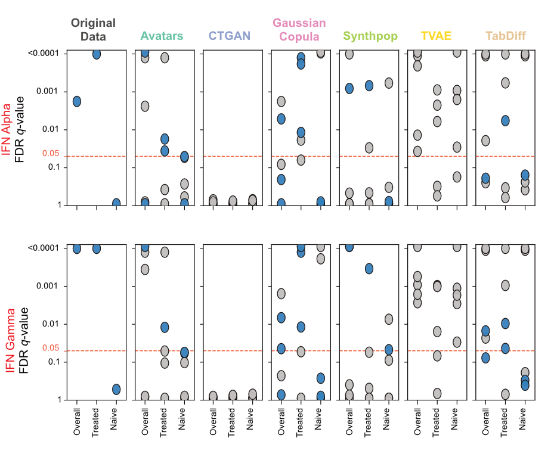
***Figure 12**: Treatment-stratified IFN response in Melanoma: FDR q-values of the IFN-γ and IFN-α response pathways overall, in ipilimumab-treated and in ipilimumab-naive patients, for five replicates of each SDG method.*

### Predictive Modeling

Liu et al. developed a logistic regression model predicting progression under combined anti-PD-1 and anti-CTLA-4 therapy from the MHC class II score, lymph node metastasis status and LDH level. Classifiers were trained on synthetic data only and evaluated on held-out original data (5-fold cross-validation repeated three times), and compared with the model trained on the original data by a Bayesian correlated t-test (equivalence margin 0.05 ROC-AUC). **Avatars** and **Gaussian Copula** each had two replicates ranging from equivalence to the real-data baseline to no detectable difference, and CTGAN produced one equivalent replicate. Avatars and TabDiff were the only methods whose ROC-AUC exceeded chance level in all five replicates. Models trained on Gaussian Copula and Avatars data largely preserved the negative coefficients of the three prognostic features (12 and 13 of 15 coefficient signs across replicates, respectively) (**Figure 13**).

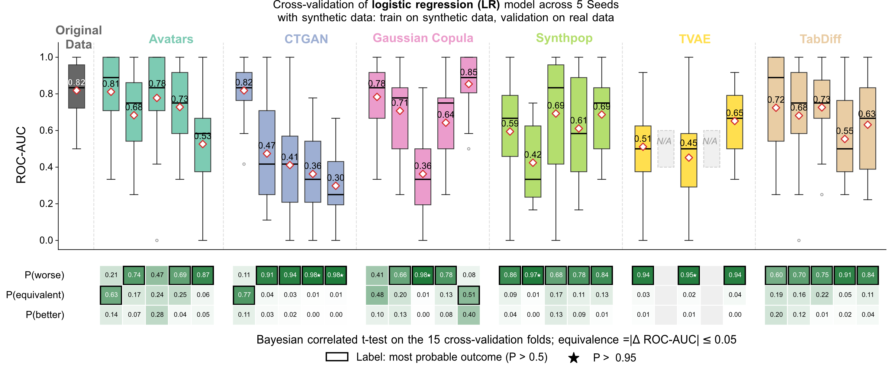
***Figure 13**: Logistic regression trained on each synthetic replicate and evaluated on held-out original data (5-fold cross-validation, repeated three times). Below each box, the posterior probabilities that the synthetic-trained model is worse than, practically equivalent to (|ΔROC-AUC| ≤ 0.05) or better than the original-trained model; the outlined cell is the most probable outcome when its probability exceeds 0.5, and a star marks a probability above 0.95.*

### Cell Type Deconvolution

LM22 immune cell types showed no significant difference between responders and progressors in the original Melanoma data, and accordingly no SDG method produced stable results. For the single-cell-derived signatures of the Melanoma publication, all methods except CTGAN preserved the direction of enrichment in responders, with markedly attenuated significance. **TabDiff** reversed the direction of most signatures in three of five replicates. TVAE and TabDiff nominally recovered several signatures, with significance exceeding that of the original data in some replicates, but these results should be read with caution given their distortion of the responder-to-progressor ratio (TVAE: 10.1%–692.9%; TabDiff: 34.6%–94.5%; original data: 83.9%) (**Figure 14**).

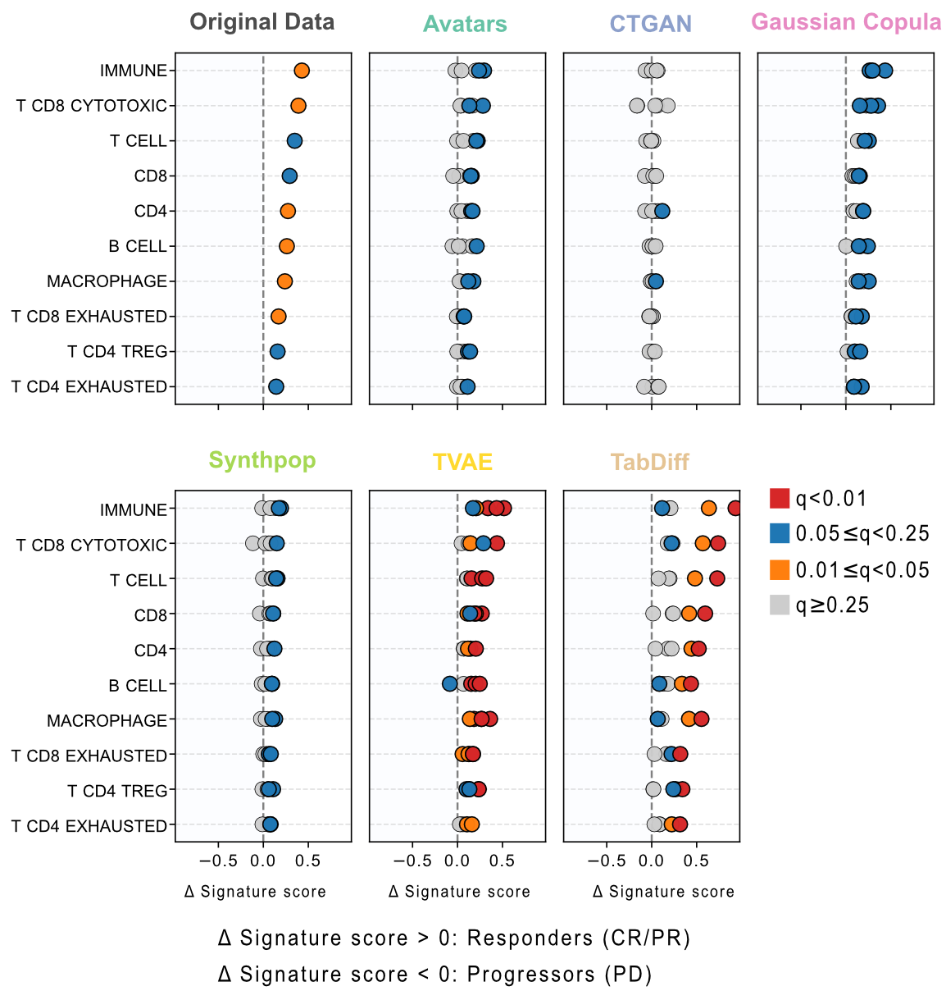
***Figure 14**: Single-cell-derived immune signatures in Melanoma: mean difference of the signature score between responders and progressors, original data and five replicates of each SDG method. Colors indicate FDR-adjusted significance (two-sided Wilcoxon rank-sum test).*

### Survival Analysis

In the three cohorts, the response to treatment separates survival strongly in the original data (C-index 0.66–0.77), and the survival score measures whether a synthetic dataset reproduces this association. **Avatars** and **Gaussian Copula** preserved global survival discrimination, with survival scores above 0.9; in every one of their replicates, the 95% confidence interval of the synthetic C-index lay above chance and the hazard ratio pointed in the original direction. The synthetic C-indices of CTGAN and Synthpop (mean 0.51–0.55) were close to chance and those of TabDiff only modestly higher (0.57–0.64).

Liu et al. also stratified ipilimumab-treated patients with a model combining the MHC class II score and clinical features. The model was retrained on each synthetic dataset and its predicted risk scores used to stratify progression-free survival (**Figure 15**).

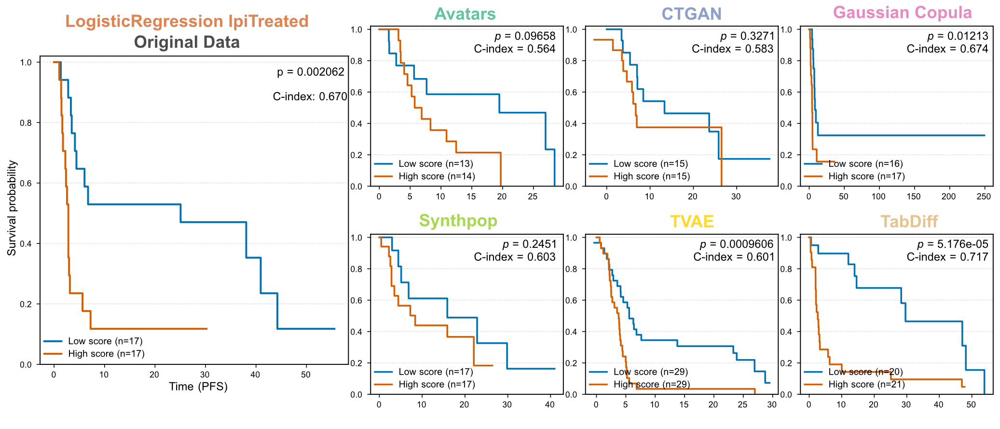
***Figure 15**: Progression-free survival of the ipilimumab-treated Melanoma cohort stratified by the risk group predicted by a logistic regression model (low score: blue; high score: orange), retrained on each synthetic dataset; best recapitulated replicate of each method, with log-rank P-values and C-indices.*

---

## NSCLC

**Cohort**: 152 patients with advanced non-small cell lung cancer from the Stand Up To Cancer-Mark Foundation (SU2C-MARK) cohort, treated with PD-1/PD-L1 blockade. Original study by [Ravi et al. (*Nature Genetics*, 2023)](https://doi.org/10.1038/s41588-023-01355-5).

Ravi et al. performed the first integrative analysis of genomic and transcriptomic biomarkers in a large NSCLC-specific ICB cohort, revealing that myeloid-driven immune programs, particularly immunoproteasome components and macrophage/monocyte signatures, play a central role in determining checkpoint blockade response.

### Differential Gene Expression

The enrichment of the **immunoproteasome** components (PSME1, PSME2, PSMB8, PSMB9 and PSMB10) in responders, over the canonical IFN-γ targets and the proteasome components, was recovered by **Avatars** and **Gaussian Copula** (*P* < 0.01). TabDiff varied across replicates, reproducing both contrasts in only one of five replicates, and TVAE reproduced only the contrast against the IFN-γ targets. CTGAN did not recover this pattern (**Figure 16**).

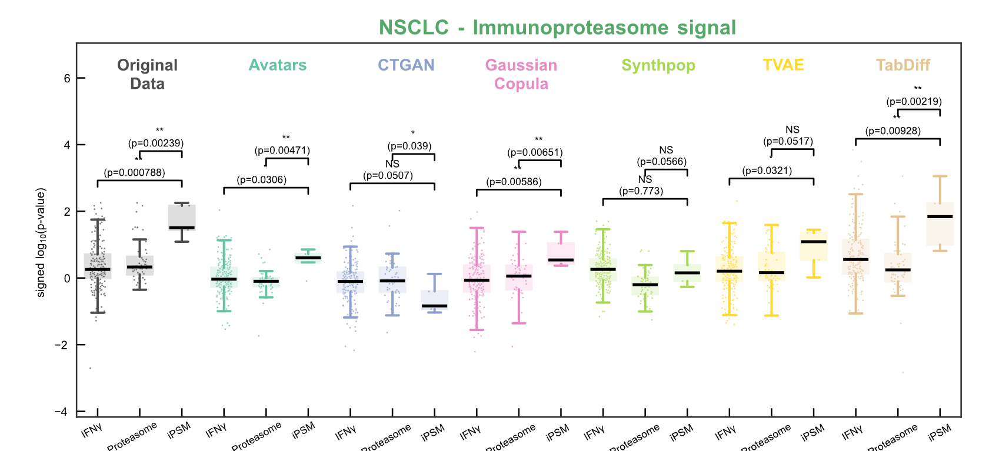
***Figure 16**: Re-discovery of the immunoproteasome enrichment in NSCLC: signed $-\log_{10}(p\text{-value})$ distributions of IFN-γ response genes, canonical proteasome genes and immunoproteasome (iPSM) components between responders and non-responders. Two-sided Wilcoxon rank-sum test.*

### Gene Set Enrichment Analysis

Gaussian Copula ranked first on F1-PCS in NSCLC, but recovered fewer than 60% of the original significant pathways with a concordant direction. The agreement of the immune-related pathways is shown with Melanoma in **Figure 11**.

### Cell Type Deconvolution

LM22 immune cell types showed no significant difference between responders and non-responders in the original NSCLC data. The higher-order co-regulation of the **wound-healing/immunosuppressive** cluster (C1, resistance-associated) and the **immune activation/exhaustion** cluster (C2, response-associated) was preserved only by **Gaussian Copula** and **Avatars**, in all five replicates, and largely lost by the other methods (**Figure 17**).

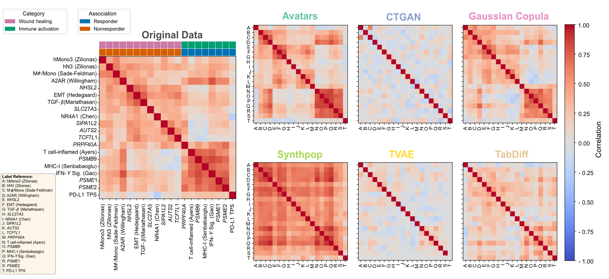
***Figure 17**: Correlation matrices of the biological signatures of the NSCLC cohort, original data and one replicate of each SDG method. Clustering of the original data separates a wound-healing/immunosuppressive stromal cluster (C1) from an immune activation/exhaustion cluster (C2).*

### Survival Analysis

Ravi et al. reported that, among patients with high PD-L1 expression (TPS ≥ 50%), increased **macrophage/monocyte infiltration** was associated with poor prognosis (*P* < 0.05). As in ccRCC and Melanoma, Gaussian Copula and TabDiff were the only methods to reach a significant patient classification, with low robustness across replicates (**Figure 18**).

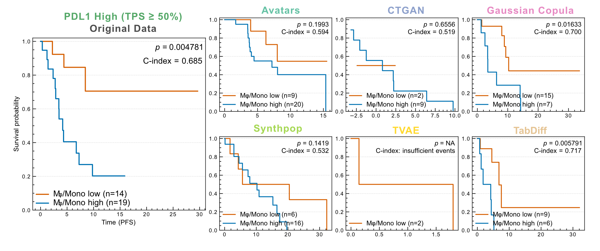
***Figure 18**: Progression-free survival of PD-L1-high (TPS ≥ 50%) NSCLC patients with low (orange) versus high (blue) macrophage/monocyte signature scores; best recapitulated replicate of each SDG method, with log-rank P-values and C-indices.*
