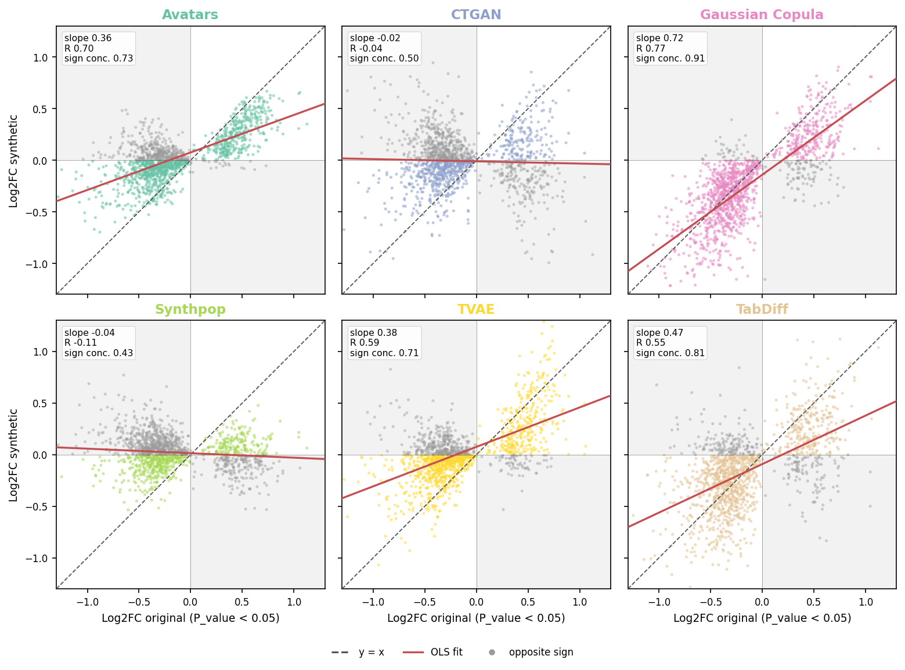

# Differential Gene Expression (DGE)

DGE analysis identifies genes with statistically significant expression changes between biological conditions. SynOmicsBench compares the DGE results of the original and synthetic data on two levels: whether the synthetic data recover the same differentially expressed genes (DEGs) with the same direction (**F1-GCS**), and whether the effect sizes of the original DEGs are preserved (**effect-size calibration**).

## Gene Concordance Score (F1-GCS)

### Rank score

Each gene $i$ is assigned a rank score combining effect size and significance:

$$\text{RS}_i = \text{sign}(\log_2\text{FC}_i) \times \bigl(-\log_{10}(s_i)\bigr)$$

where $s_i$ is the significance value of the gene (column `sig_col`: nominal P-value or FDR Q-value, as the user decides), clipped at 0.001. A gene is differentially expressed when $s_i$ is below `sig_thr` (default 0.05).

### Recall, precision and F1-score

With $N_\text{sig}$ the number of genes differentially expressed in both datasets with the same direction:

$$\text{Recall} = \frac{N_\text{sig}}{N_\text{sig}^\text{original}}, \qquad \text{Precision} = \frac{N_\text{sig}}{N_\text{sig}^\text{synthetic}}, \qquad \text{F1-GCS} = \frac{2 \cdot \text{Precision} \cdot \text{Recall}}{\text{Precision} + \text{Recall}}$$

Recall is the fraction of the original DEGs recovered with the same direction; precision the fraction of the synthetic DEGs that are concordant original DEGs. When the synthetic data have no DEG, precision is undefined (NaN) and F1-GCS is 0; F1-GCS is 0 whenever no gene is concordant.

## Effect-size calibration

On the genes significant in the original data, the synthetic Log2FC is regressed on the original Log2FC by ordinary least squares:

- **Slope**: 1 means effect sizes are preserved, below 1 attenuated, above 1 inflated;
- **Pearson**: how tightly the genes follow the regression line;
- **SignConcordance**: fraction of the original DEGs whose synthetic Log2FC has the same sign. Genes with a zero Log2FC have no sign and are left out.

Genes with a non-finite Log2FC are dropped; slope and correlation need at least 3 genes.

## Code Example

```python
import pandas as pd
from synomicsbench.metrics.narrow_utility.DGE import GCSAnalyzer

original_dge = pd.read_csv("original_dge_path.csv")
synthetic_dge = pd.read_csv("synthetic_dge_path.csv")

analyzer = GCSAnalyzer(
    term_col="Gene",
    nes_col="Log2FC",
    sig_col="P_value",   # or "Q_value"
    sig_thr=0.05,
)

# One metric -> float
f1 = analyzer.compute_metrics(original_dge, synthetic_dge, metrics="F1")

# Several metrics -> dict (metrics=None returns all of them)
scores = analyzer.compute_metrics(
    original_dge, synthetic_dge,
    metrics=["Recall", "Precision", "F1", "Slope", "Pearson", "SignConcordance"],
)
```

Available metrics: `Recall`, `Precision`, `F1`, `Slope`, `Pearson`, `SignConcordance`.

To compare several synthetic datasets at once:

```python
dataset_dict = {
    "Avatars": "DGE/avatars_0.csv",
    "CTGAN": "DGE/ctgan_0.csv",
    "Gaussian Copula": "DGE/gaussiancopula_0.csv",
    "Synthpop": "DGE/synthpop_0.csv",
    "TVAE": "DGE/tvae_0.csv",
    "TabDiff": "DGE/tabdiff_0.csv",
}

table = analyzer.compute_metrics_datasets("DGE/origin.csv", dataset_dict)
# one row per dataset, one column per metric
```

## Effect-size calibration plot

The calibration plot shows the synthetic versus original Log2FC of the original DEGs, with the identity line, the OLS fit and, in each panel, the slope, Pearson R and sign concordance. Groups of genes can be highlighted:

```python
fig, calibration = analyzer.plot_calibration_scatter(
    ori_data="DGE/origin.csv",
    dataset_dict=dataset_dict,
    highlight={
        "MHC-I": ["HLA-A", "HLA-B", "HLA-C", "B2M"],
        "MHC-II": ["HLA-DRA", "HLA-DRB1", "HLA-DPA1"],
    },
)
fig.savefig("dge_calibration_scatter.png", dpi=300, bbox_inches="tight")
```

`calibration` is a table with the OLS slope and intercept, Pearson correlation, sign concordance (with its binomial test P-value) and number of genes of each dataset.



*Log2FC of the genes differentially expressed in the original Melanoma cohort (responders versus progressors), original versus synthetic (seed 0), with slope, Pearson R and sign concordance in each panel.*
