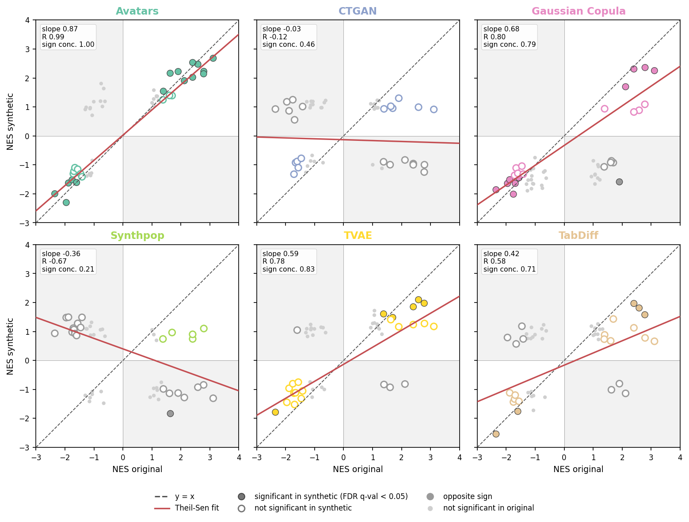

# Gene Set Enrichment Analysis (GSEA)

GSEA identifies biological pathways that are coordinately regulated between conditions. Unlike DGE which focuses on individual genes, GSEA considers entire functional gene sets.

## Pathway Concordance Score (F1-PCS)

F1-PCS follows the same framework as [F1-GCS](dge.md), at the pathway level.

### Rank Score Calculation

For each pathway $p$, a rank score integrates the direction and significance of enrichment:

$$\text{RS}_p = \text{sign}(\text{NES}_p) \times \bigl(-\log_{10}(s_p)\bigr)$$

where $s_p$ is the significance value of the pathway (column `sig_col`, by default the FDR q-value), clipped at 0.001.

### Recall, Precision and F1-score

With $N_\text{sig}$ the number of pathways significant in both datasets with the same NES sign:

$$\text{Recall} = \frac{N_\text{sig}}{N_\text{sig}^\text{original}}, \qquad \text{Precision} = \frac{N_\text{sig}}{N_\text{sig}^\text{synthetic}}, \qquad \text{F1-PCS} = \frac{2 \cdot \text{Precision} \cdot \text{Recall}}{\text{Precision} + \text{Recall}}$$

A synthetic dataset can call no pathway significant: precision is then undefined (NaN) and F1-PCS is 0, recording that nothing was recovered.

## NES calibration

On the pathways significant in the original data, the synthetic NES is regressed on the original NES with the Theil–Sen estimator (`Slope`), the median of the pairwise slopes, which one outlying pathway cannot pull with the few significant pathways; `Pearson` is their correlation and `SignConcordance` the fraction of those pathways enriched in the same direction.

## Code Example

```python
import pandas as pd
from synomicsbench.metrics.narrow_utility.GSEA import PCSAnalyzer

analyzer = PCSAnalyzer(
    term_col="Term",
    nes_col="NES",
    sig_col="FDR q-val",   # or "NOM p-val"
    sig_thr=0.05,
)
ori_gsea = pd.read_csv("original_gsea_result.csv")
syn_gsea = pd.read_csv("synthetic_gsea_result.csv")

f1 = analyzer.compute_metrics(ori_gsea, syn_gsea, metrics="F1")
scores = analyzer.compute_metrics(ori_gsea, syn_gsea)   # all metrics

print(f"F1-PCS: {scores['F1']:.3f}  (recall {scores['Recall']:.3f}, precision {scores['Precision']:.3f})")
```

Available metrics: `Recall`, `Precision`, `F1`, `Slope`, `Pearson`, `SignConcordance`. Several synthetic datasets are compared with `analyzer.compute_metrics_datasets(ori_data, dataset_dict)`.

## NES calibration plot

The calibration plot shows the synthetic versus original NES of the pathways significant in the original data, with the identity line, the Theil–Sen fit and, in each panel, the slope, Pearson R and sign concordance. Filled points are also significant in the synthetic data, open points are not, and grey points have the opposite sign; the small light grey points are the pathways not significant in the original data, shown for context and left out of the fit:

```python
dataset_dict = {
    "Avatars": "GSEA/avatars_42.csv",
    "CTGAN": "GSEA/ctgan_42.csv",
    "Gaussian Copula": "GSEA/gaussiancopula_42.csv",
    "Synthpop": "GSEA/synthpop_42.csv",
    "TVAE": "GSEA/tvae_42.csv",
    "TabDiff": "GSEA/tabdiff_42.csv",
}

fig, calibration = analyzer.plot_calibration_scatter("GSEA/original_data.csv", dataset_dict)
fig.savefig("gsea_calibration_scatter.png", dpi=300, bbox_inches="tight")
```

`calibration` is a table with the Theil–Sen slope and intercept, Pearson correlation, sign concordance and number of pathways of each dataset.



*NES of the Hallmark pathways significant in the original NSCLC cohort (responders versus progressors), original versus synthetic data of each SDG method.*
