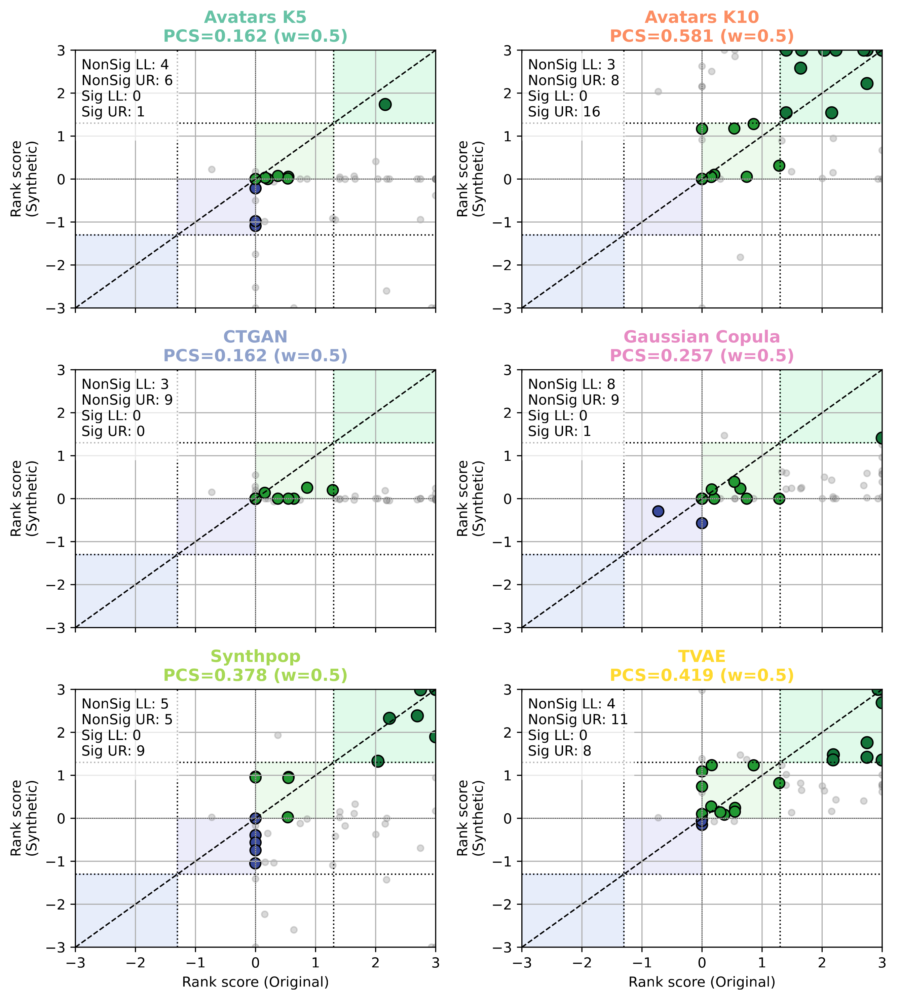

# Gene Set Enrichment Analysis (GSEA)

GSEA identifies biological pathways that are coordinately regulated between conditions. Unlike DGE which focuses on individual genes, GSEA considers entire functional gene sets.

## Pathway Concordance Score (F1-PCS)

F1-PCS follows the same framework as [F1-GCS](dge.md), at the pathway level.

### Rank Score Calculation

For each pathway $p$, a rank score integrates the direction and significance of enrichment:

$$\text{RS}_p = \text{sign}(\text{NES}_p) \times \bigl(-\log_{10}(s_p)\bigr)$$

where $s_p$ is the significance value of the pathway (column `sig_col`, by default the FDR q-value), clipped at 0.001.

### Recall, Precision and F1-score

With $N_\text{sig}$ the number of pathways significant in both datasets with the same NES sign:

$$\text{Recall} = \frac{N_\text{sig}}{N_\text{sig}^\text{original}}, \qquad \text{Precision} = \frac{N_\text{sig}}{N_\text{sig}^\text{synthetic}}, \qquad \text{F1-PCS} = \frac{2 \cdot \text{Precision} \cdot \text{Recall}}{\text{Precision} + \text{Recall}}$$

A synthetic dataset can call no pathway significant: precision is then undefined (NaN) and F1-PCS is 0, recording that nothing was recovered.

## NES calibration

On the pathways significant in the original data, the synthetic NES is regressed on the original NES (`Slope`, `Slope_robust`, `Pearson`), and `SignConcordance` gives the fraction of those pathways enriched in the same direction (chance level 0.5). With few pathways the Theil–Sen slope (`Slope_robust`) is the recommended slope.

## Code Example

```python
import pandas as pd
from synomicsbench.metrics.narrow_utility.GSEA import PCSAnalyzer

analyzer = PCSAnalyzer(
    term_col="Term",
    nes_col="NES",
    sig_col="FDR q-val",   # or "NOM p-val"
    sig_thr=0.05,
)
ori_gsea = pd.read_csv("original_gsea_result.csv")
syn_gsea = pd.read_csv("synthetic_gsea_result.csv")

f1 = analyzer.compute_metrics(ori_gsea, syn_gsea, metrics="F1")
scores = analyzer.compute_metrics(ori_gsea, syn_gsea)   # all metrics

# Zone counts and the points of the rank-score plot
x, y, result = analyzer.process_single_gsea_result(ori_gsea, syn_gsea)
print(f"F1-PCS: {result.f1:.3f}  (recall {result.recall:.3f}, precision {result.precision:.3f})")
```

Available metrics: `Recall`, `Precision`, `F1`, `Slope`, `Slope_robust`, `Pearson`, `SignConcordance`. Several synthetic datasets are compared with `analyzer.compute_metrics_datasets(ori_data, dataset_dict)`.

## Scatter Plot Visualization

```python
dataset_dict = {
    "Avatars K5": "GSEA/avatarsk5_0.csv",
    "CTGAN": "GSEA/ctgan_0.csv",
    "Gaussian Copula": "GSEA/gaussiancopula_0.csv",
    "Synthpop": "GSEA/synthpop_0.csv",
    "TVAE": "GSEA/tvae_0.csv",
    "Diffusion": "GSEA/tabdiff_0.csv",
}

# Concordance zones, F1-PCS in each panel
fig, f1_dict = analyzer.plot_gsea_datasets(
    ori_data="GSEA/original_data.csv",
    dataset_dict=dataset_dict,
    figsize=(9, 10),
)
fig.savefig("gsea_pcs_scatter.png", dpi=300, bbox_inches="tight")

# NES calibration of the pathways enriched in the original
fig, calibration = analyzer.plot_calibration_scatter("GSEA/original_data.csv", dataset_dict)
```



*Scatter plots of pathway rank scores (Original vs. Synthetic) for each SDG method in the Melanoma cohort.*
