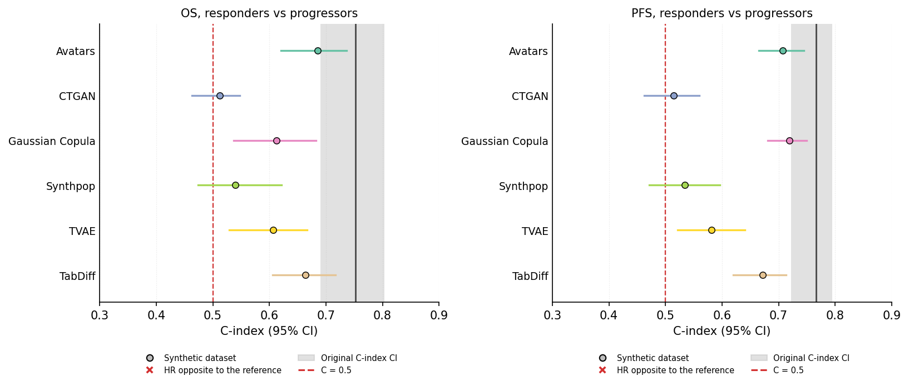
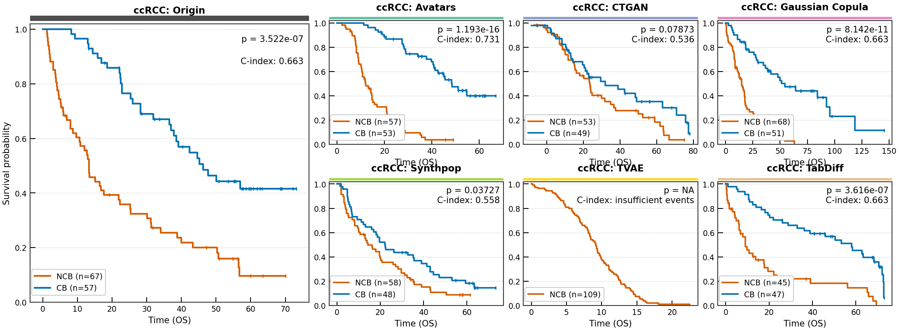

# Survival Analysis

Survival analysis evaluates whether synthetic data preserves clinically meaningful survival patterns by comparing Overall Survival (OS) and Progression-Free Survival (PFS) between treatment responders and non-responders.

## Survival score

The **survival score** compares the concordance index (C-index) of a Cox proportional hazards model fitted on the original data with the one fitted on the synthetic data, with the phenotype group (e.g. responders versus non-responders) as single covariate:

$$C_\text{score}^\text{OS} = 1 - \left|C_\text{original}^\text{OS} - C_\text{synthetic}^\text{OS}\right|$$

$$C_\text{score}^\text{PFS} = 1 - \left|C_\text{original}^\text{PFS} - C_\text{synthetic}^\text{PFS}\right|$$

$$\text{survival score} = \frac{C_\text{score}^\text{OS} + C_\text{score}^\text{PFS}}{2}$$

Higher values indicate greater agreement in survival discrimination. Choose a covariate with a strong survival association in the original data: a high score then requires the synthetic data to reproduce it, and cannot come from two C-indices close to 0.5. Kaplan-Meier survival curves are compared using the **log-rank test**.

## Code Example

```python
from synomicsbench.metrics.narrow_utility.survival_analysis import  SurvivalEvaluator

# Define dataset dictionary
survival_cols = ["OS", "OS_CNSR", "Benefit"]
original_data = pd.read_csv("original_data.csv")
synthetic_data = pd.read_csv("synthetic_data.csv")

dataset_dict = {
    "Origin": original_data[survival_cols],
    "Synthetic_data": synthetic_data[survival_cols],
}


# Define phenotype comparison
phenotype = {"Benefit": ["CB", "NCB"]}

# Define evaluator
evaluator = SurvivalEvaluator(
    datasets_dict=dataset_dict,
    phenotype=phenotype,
    time_target="OS",
    event_target="OS_CNSR",
    original_name="Origin"
)

# Survival score of each dataset with respect to the original data
summary_df = evaluator.compute_survival_metrics()
scored_df = evaluator.compute_survival_scores(original_name="Origin")

synthetic_score = scored_df.loc[scored_df["Dataset"] == "Synthetic_data", "Survival_score"].values[0]
print(f"Synthetic Score: {synthetic_score:.4f}")
```

## C-index confidence interval, hazard ratio and its direction

The survival score alone does not show whether the survival signal itself is reliable, nor whether its direction is preserved. `compute_cox_metrics()` reports, for every dataset:

- **C-index** of a Cox model with the phenotype group as single covariate (first phenotype value coded 1), with its **bootstrap confidence interval** (`CI_low`, `CI_high`; the Cox model is refitted on every resample);
- **HR**, the hazard ratio of the first phenotype value versus the second;
- **HR_same_direction**: 1 when the hazard ratio lies on the same side of 1 as in the reference data, 0 when the association is reversed;
- **Survival_score** = 1 − |C<sub>synthetic</sub> − C<sub>original</sub>|, together with the log-rank P-value and the number of patients and events per group.

```python
evaluator = SurvivalEvaluator(
    datasets_dict=dataset_dict,
    phenotype={"Benefit": ["CB", "NCB"]},
    time_target="OS",
    event_target="OS_CNSR",
    original_name="Origin",
)
cox = evaluator.compute_cox_metrics(n_bootstrap=1000, confidence_level=0.95, seed=0)
print(cox[["Dataset", "C-index", "CI_low", "CI_high", "HR", "HR_same_direction", "Survival_score"]])

# Forest plot: C-index and CI of every synthetic dataset against the original CI (grey band);
# a red cross marks a hazard ratio reversed with respect to the original.
fig, _ = evaluator.plot_cindex_forest()
fig.savefig("cindex_forest.png", dpi=300, bbox_inches="tight")
```



*C-index (95% bootstrap CI) of the Cox model comparing responders and progressors in the Melanoma cohort, for the original data (grey band) and one synthetic replicate (seed 0) of each SDG method.*

The bootstrap is reproducible: the k-th dataset with a C-index is resampled with seed `seed + k`.

## Kaplan-Meier Curve Visualization

```python
from synomicsbench.metrics.narrow_utility.survival_analysis import  SurvivalEvaluator

# Define datasets: the key for the reference must match original_name
datasets = {
    "Origin": real_df,
    "Gaussian Copula": gc_df,
    "Avatars": avatars_df,
    "CTGAN": ctgan_df,
    "Synthpop": synthpop_df,
    "TVAE": tvae_df,
    "TabDiff": tabdiff_df,
}

phenotype = {"Benefit": ["CB", "NCB"]}

evaluator = SurvivalEvaluator(
    datasets_dict=datasets,
    phenotype=phenotype,
    time_target="OS",
    event_target="OS_CNSR",
    original_name="Origin"
)
evaluator.compute_survival_metrics()
fig, summary = evaluator.plot_grid(
    save_dir="survival_analysis_results/"
)

# Each panel shows: Kaplan-Meier curves, log-rank P value, C-index
```



*Overall survival of patients with and without clinical benefit (CB, NCB) in the ccRCC cohort, original data and one synthetic replicate (seed 0) of each SDG method, with the log-rank P-value and C-index in each panel. TVAE generated no patient with clinical benefit in this cohort.*

*Survival signal preservation across SDG methods. Log-rank P values and C-indices are annotated in each panel.*