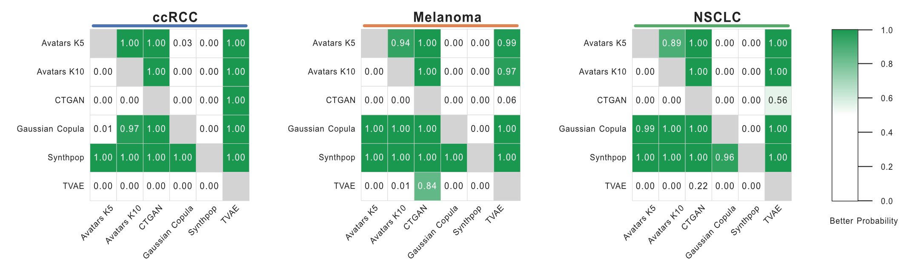

# Evaluation Framework

SynOmicsBench evaluates synthetic cancer omics data across three complementary dimensions to ensure that generated datasets are statistically similar to the original (Statistical fidelity), biologically meaningful for downstream analyses (Biological utility), and safe for data sharing (Privacy). This multidimensional approach addresses the fundamental trade-off between utility and privacy.

---

## Evaluation Dimensions

Our evaluation framework is organized into three distinct pillars, each measuring different aspects of synthetic data quality:

### [Statistical Fidelity](statistical-fidelity.md)

Statistical fidelity assesses how well the synthetic data preserves the global statistical properties of the original dataset.
<div class="grid cards" markdown>

-   **[Univariate Similarity](statistical-fidelity.md#univariate-similarity)**

-   **[Bivariate Similarity](statistical-fidelity.md#bivariate-similarity)**

-   **[Co-expression Network Preservation](statistical-fidelity.md#co-expression-network-preservation)**
</div>

This dimension provides the first line of evaluation for any synthetic data generation method.

### Biological Utility

Biological utility focuses on task-specific performance in clinically relevant downstream analyses. Statistical fidelity does not always guarantee that biological signals are preserved for scientific discovery.

<div class="grid cards" markdown>

-   **[Differential Gene Expression (DGE)](biological-utility/dge.md)**

-   **[Gene Set Enrichment (GSEA)](biological-utility/gsea.md)**

-   **[Single-sample Gene Set Enrichment (ssGSEA)](biological-utility/ssgsea.md)**

-   **[Cell Type Deconvolution](biological-utility/cell-deconvolution.md)**

-   **[Survival Analysis](biological-utility/survival-analysis.md)**

</div>

These tasks directly assess whether synthetic data can support real-world biological research.

### [Privacy Risk](privacy.md)

Privacy evaluation quantifies the disclosure vulnerability of the synthetic data, aligned with European Data Protection Board (EDPB) principles. We leverage the [Anonymeter Framework](https://petsymposium.org/popets/2023/popets-2023-0055.php) to evaluate the privacy risk under three attack scenarios:

- **Singling-Out**: The risk of isolating a unique individual in the dataset based on their attributes
- **Linkability**: The risk of connecting records from the synthetic dataset to the original or other external datasets
- **Inference**: The risk of deducing sensitive attribute values from other available information

Each attack can be run against an external control cohort (patients the generator never saw) to report the residual risk attributable to the synthetic data.

### [Automatic Benchmark](autobenchmark.md)

Rather than computing each of the three pillars separately and aggregating the results by hand, the **Automatic Benchmark** computes the twelve metrics, or any subset of them, in one call. It ranks the synthetic datasets into a rank-derived meta-score, tests how the ranking depends on the pillar weights, and writes a report. It is the recommended entry point to compare several SDG methods.

---

## Bayesian Comparison Framework

The high computational cost of synthetic data generaion under clinical transcriptomic settings constrains the number of generating replicates to which traditional p-values are not robust. To address the limited sample size and maximize the robustness of comparison, we implement a rigorous Bayesian comparison approach. The Bayesian approach enables an uncertainty-aware comparison by estimating the probability that one method outperforms another across the distribution of replicates, thereby avoiding binary conclusions while remaining appropriate for small-sample evaluation.

### Methodology

We perform pairwise Bayesian comparisons following the framework proposed by [Benavoli et al.](https://jmlr.org/papers/v18/16-305.html), using the *baycomp* Python library. A Bayesian correlated t-test is applied to estimate posterior probabilities for three mutually exclusive hypotheses:

- **Better probability** ($P(SDG_{1} > SDG_{2})$): the probability that $SDG_{1}$ outperforms $SDG_{2}$
- **Worse probability** ($P(SDG_{1} < SDG_{2})$): the probability that $SDG_{1}$ underperforms $SDG_{2}$
- **Practical equivalent probability**: the probability that the performance difference lies within a predefined Region of Practical Equivalence (ROPE)


### Usage Example

#### Pairwise Comparison

To compare specific methods and obtain the Bayesian probability estimates:

```python
from synomicsbench.metrics.fidelity.BayesianComparison import BayesianComparison

bc = BayesianComparison(rope=0.01)

score_ccrcc = {
    'Avatars': [0.8905, 0.8906, 0.8888, 0.8913, 0.8881],
    'CTGAN': [0.8057, 0.8217, 0.8168, 0.8092, 0.835]
}

compare_result = bc.compare_methods(
    method_to_scores=score_ccrcc,
    methods_order=['Avatars', 'CTGAN'],
)
```

**Output:**

| Method 1 | Method 2 | Better Prob | Worse Prob | Equivalent Prob |
|:---------|:---------|------------:|-----------:|----------------:|
| Avatars  | CTGAN    |    0.999097 |   0.000311 |        0.000592 |
| CTGAN    | Avatars  |    0.000311 |   0.999097 |        0.000592 |

#### Heatmap Visualization

You can also compute and visualize probability heatmaps for multiple cohorts and methods simultaneously:

```python
from synomicsbench.metrics.fidelity.BayesianComparison import BayesianComparison

Univariate_Score_Dict = {
    'ccRCC': {
        'Avatars': [0.8905, 0.8906, 0.8888, 0.8913, 0.8881],
        'CTGAN': [0.8057, 0.8217, 0.8168, 0.8092, 0.835],
        'Gaussian Copula': [0.8886, 0.8908, 0.8869, 0.8838, 0.8939],
        'Synthpop': [0.9532, 0.9517, 0.9503, 0.9534, 0.9518],
        'TVAE': [0.621, 0.6637, 0.5813, 0.6395, 0.631],
        'TabDiff': [0.8354, 0.8364, 0.8218, 0.8298, 0.8234],
    },
    'Melanoma': {
        'Avatars': [0.8566, 0.8558, 0.8552, 0.8617, 0.8565],
        'CTGAN': [0.7627, 0.783, 0.7676, 0.7807, 0.7386],
        'Gaussian Copula': [0.891, 0.8946, 0.8927, 0.8936, 0.8947],
        'Synthpop': [0.9162, 0.9269, 0.9306, 0.9219, 0.9228],
        'TVAE': [0.8155, 0.7688, 0.8111, 0.8032, 0.8118],
        'TabDiff': [0.8624, 0.863, 0.8726, 0.8707, 0.8894],
    },
    'NSCLC': {
        'Avatars': [0.8698, 0.8703, 0.8672, 0.864, 0.8641],
        'CTGAN': [0.7501, 0.7827, 0.7734, 0.7251, 0.7767],
        'Gaussian Copula': [0.8996, 0.8936, 0.9017, 0.9065, 0.9058],
        'Synthpop': [0.9231, 0.9283, 0.9296, 0.9232, 0.9185],
        'TVAE': [0.7441, 0.7549, 0.7121, 0.7793, 0.746],
        'TabDiff': [0.8797, 0.8633, 0.8499, 0.871, 0.8673],
    },
}

bc = BayesianComparison(rope=0.01)
cancers = ["ccRCC", "Melanoma", "NSCLC"]
methods_order = ["Avatars", "CTGAN", "Gaussian Copula", "Synthpop", "TVAE", "TabDiff"]
fig, axes, mats_by_cancer, comp_by_cancer = bc.plot_pbetter_heatmap_grid(
    cancer_to_method_scores=Univariate_Score_Dict,
    cancers_order=cancers,
    methods_order=methods_order,
    value_col="Better Prob", 
    figsize=(18, 5),
    annot=True,
    fmt=".2f",
)

fig.savefig("bayesian_comp_fig2c_uni.pdf", bbox_inches="tight", facecolor="white")

for cancer in cancers:
    bayesian_comp_df = comp_by_cancer[cancer]
    bayesian_comp_df.to_csv(f'UnivariateBayesian_estimation_{cancer}.csv')
```
