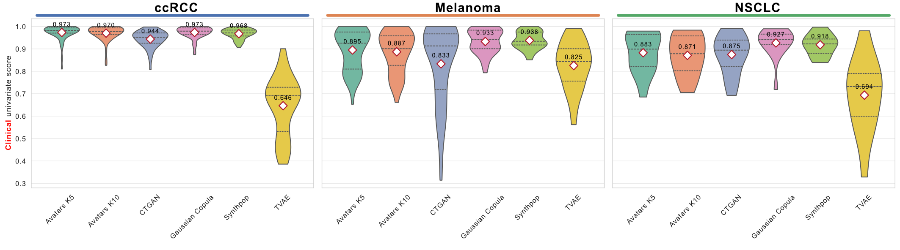
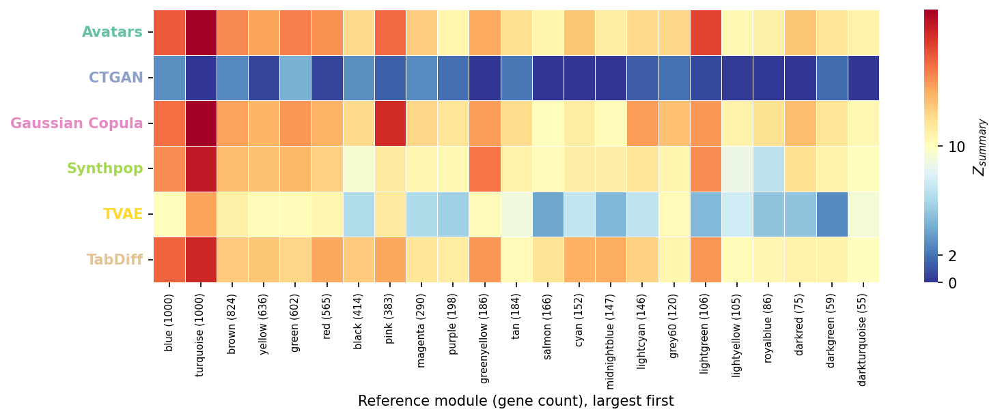

# Statistical Fidelity

Statistical fidelity evaluates how faithfully synthetic data reproduces the **statistical properties** of the original dataset at two levels: marginal distributions of individual features (univariate similarity) and pairwise relationships between features (bivariate similarity).

## Univariate Similarity

Univariate similarity measures how well the distribution of each individual feature is preserved.

### Metrics

- **Numerical features**: the [Kolmogorov–Smirnov (KS)](https://docs.sdv.dev/sdmetrics/data-metrics/quality/kscomplement) statistic measures the maximum distance between the cumulative distributions:

$$s_k = 1 - \text{KS}\!\bigl(\text{CDF}(F_k^{\text{original}}),\; \text{CDF}(F_k^{\text{synthetic}})\bigr)$$

- **Categorical features**: the [Total Variation Distance (TVD)](https://docs.sdv.dev/sdmetrics/data-metrics/quality/tvcomplement) quantifies the discrepancy between frequency distributions:

$$s_k = 1 - \text{TVD}(F_{k,\text{original}},\; F_{k,\text{synthetic}})$$

To ensure balanced evaluation across modalities, the final univariate score averages the mean scores of clinical and transcriptomic features separately:

$$\text{UnivariateScore}_A = \frac{1}{2}\left(\frac{1}{N}\sum_{i \in \text{Clinical}}^{N} s_i + \frac{1}{M}\sum_{j \in \text{Transcriptomic}}^{M} s_j\right)$$

where $N$ and $M$ denote the total number of clinical features and genes, respectively.

---

### Code Example

```python
from synomicsbench.metrics.fidelity.UnivariateSimilarity import UnivariateSimilarity
from synomicsbench.processing.metadata import MetaData

# Compute metadata (auto-detect feature types)
metadata = MetaData.get_metadata(
    data=original_data,
    threshold_unique_values=10,
    ordinal_features=None
)

# Compute univariate similarity scores
uni = UnivariateSimilarity(output_dir="results/statistical_fidelity")
scores = uni.get_univariate_score(
    original_data=original_data,
    synthetic_data=synthetic_data,
    metadata=metadata
)
detail_df = uni.get_detail_df()

print(f"Univariate Score: {scores:.4f}")
print(detail_df.head())
```

---

## Bivariate Similarity

Bivariate similarity evaluates how well pairwise relationships between features are preserved.

### Metrics

- **Numerical–numerical pairs**: Spearman's rank correlation ($\rho$):

$$s_{i,j} = 1 - \frac{1}{2}\left|\rho_{i,j}^{\text{original}} - \rho_{i,j}^{\text{synthetic}}\right|$$

- **Categorical–categorical and mixed pairs**: Cramér's V. For mixed pairs, numerical features are discretized into 10 bins:

$$s_{i,j} = 1 - \left|V_{i,j}^{\text{original}} - V_{i,j}^{\text{synthetic}}\right|$$

The overall bivariate score equally weights three functional modalities:

$$\text{BivariateScore}_A = \frac{1}{3}\left(\bar{S}_{\text{transcriptomic–transcriptomic}} + \bar{S}_{\text{clinical–transcriptomic}} + \bar{S}_{\text{clinical–clinical}}\right)$$

where each $\bar{S}_{\text{modality}}$ is the mean similarity score over all feature pairs within that category.

---

### Code Example


```python
from synomicsbench.metrics.fidelity.PairwiseSimilarity import PairwiseSimilarity
from synomicsbench.processing.metadata import MetaData

metadata = MetaData.get_metadata(
    data=original_data,
    threshold_unique_values=10,
    ordinal_features=None
)

pairwise = PairwiseSimilarity(
    original_data=original_data,
    synthetic_data=synthetic_data,
    metadata=metadata,
    output_dir="results/statistical_fidelity",
    name="my_dataset"
)
results = pairwise.get_pairwise_scores(method="spearman")

# results is a dict with keys: "PairwiseScore", "OriginalCorrelation", "SyntheticCorrelation"
scores = results["PairwiseScore"]
print(f"Mean Bivariate Score: {scores.mean():.4f}")
```

---

### Visualization

The violin plot below shows the distribution of per-feature similarity scores across SDG methods. The `plot_violin_grid_by_cancer` function produces manuscript-quality figures. The input dict must be structured as `{cancer: {method: [scores]}}`:

```python
from synomicsbench.metrics.fidelity.visualization import plot_violin_grid_by_cancer

# cancer_to_method_scores: {cancer_name: {method_name: [score_replicate_1, ...]}}
# Each list contains per-feature (univariate) or per-pair (bivariate) scores across replicates.
Score_Dict = {
    "ccRCC": {
        "Avatars": avatars_ccrcc_scores,
        "CTGAN": ctgan_ccrcc_scores,
        "Gaussian Copula": gc_ccrcc_scores,
        "Synthpop": synthpop_ccrcc_scores,
        "TVAE": tvae_ccrcc_scores,
        "TabDiff": tabdiff_ccrcc_scores,
    },
    "Melanoma": {
        "Avatars": avatars_melanoma_scores,
        # ...
    },
}

fig, axes, mean_by_cancer = plot_violin_grid_by_cancer(
    cancer_to_method_scores=Score_Dict,
    value_name="Univariate Score",
    figsize=(18, 5)
)
```

---

## Co-expression Network Preservation

Univariate and bivariate similarity do not tell whether the systems-level organization of the transcriptome survives synthesis. `NetworkPreservation` builds a weighted gene co-expression network (WGCNA) on the original data and uses it as the reference for every synthetic dataset.

The network uses the `n_genes` (default 10,000) genes with the largest median absolute deviation, after removing identical and constant genes; every matrix is quantile-normalised across samples. The network is a signed hybrid network with biweight midcorrelation; the soft-thresholding power is chosen on the original data (best scale-free fit among the powers keeping a mean connectivity of at least 10) and reused for the synthetic data.

### Metrics

| Metric | Definition |
|---|---|
| `Zsummary_norm` | Median Z-summary of module preservation (WGCNA `modulePreservation`, original network as reference) over the reference modules (grey and gold excluded), divided by the median Z-summary of the original data compared with itself, truncated to [0, 1]. 1 = modules preserved as well as in the original data. |
| `ARI` | Adjusted Rand index between the reference modules and the modules of a network built on the synthetic data with the reference power. |
| `TPR` | Fraction of the reference's strongest edges (top 5% of gene pairs by topological overlap) also among the synthetic network's top 5%. Both edge sets have the same size, so precision, recall and F1 coincide; chance level is 0.05. |

The raw median Z-summary depends on module sizes and sample size; dividing by the original data's own preservation puts the cohorts on a common 0–1 scale (`median_Zsummary` is reported as well). Z < 2 means no evidence and Z > 10 strong evidence of preservation.

### Code Example

WGCNA runs in R through rpy2: R and its `WGCNA` package must be installed.

```python
from synomicsbench.metrics.fidelity.NetworkPreservation import NetworkPreservation

# samples x genes; TPM-like values here, hence log_transform=True (clip(0), log2(x + 1) and a
# detection filter); pass log-scale data with log_transform=False
npres = NetworkPreservation(output_dir="network", n_genes=10_000, n_permutations=200,
                            log_transform=True, threads=8)
npres.build_reference(original[gene_cols])

scores = npres.evaluate(
    {"Gaussian Copula": gc[gene_cols], "CTGAN": ctgan[gene_cols]},
    metrics=["Zsummary_norm", "ARI", "TPR"],   # or a single name
)

# Z-summary of every reference module (columns, largest first) in every synthetic dataset;
# the colour scale is centred on Z = 10
fig, module_table = npres.plot_module_heatmap()
```



*Z-summary preservation of the co-expression modules of the original Melanoma cohort in one synthetic replicate (seed 0) of each SDG method.*
