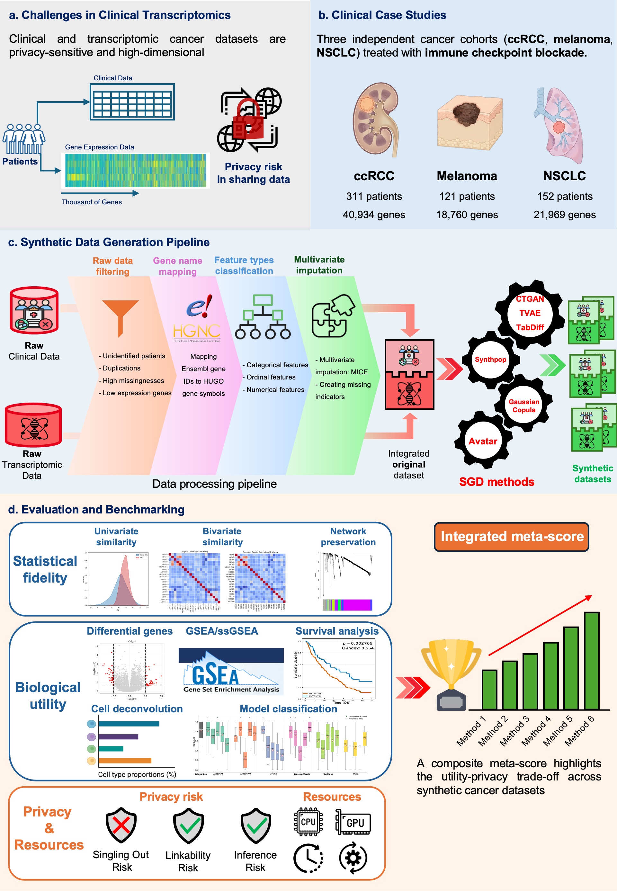

# **SynOmicsBench**: A unified benchmark of synthetic data generation for clinical trial transcriptomic cancer cohorts

Welcome to the **SynOmicsBench** documentation. This project provides a comprehensive framework for the generation, evaluation, and benchmarking of synthetic clinical trial transcriptomic data in the context of precision oncology.

!!! tip "New in 1.2.0"
    Co-expression network preservation, F1 concordance and effect-size calibration for DGE/GSEA, survival score with C-index confidence intervals and hazard-ratio direction, privacy attacks against an external control cohort, and a one-call automatic benchmark with a twelve-metric meta-score and its sensitivity to the pillar weights. See [What's new](whats-new.md).

## Abstract

Achieving a trade-off between biological utility and patient privacy remains a key challenge for secure data sharing when applying transcriptomic clinical trial datasets to artificial intelligence in precision oncology. Here, we introduce the first benchmarking study tailored to high-dimensional, low-sample-size clinical transcriptomic cancer data, comparing six synthetic data generation methods across three clinical cancer trials. Our framework, SynOmicsBench, combines standardized preprocessing with multidimensional evaluation, prioritizing downstream biological validation alongside statistical fidelity and attack-based privacy assessment. No single method dominated across all dimensions; the best generators consistently preserved the directionality of biomedical signals, albeit with attenuated effect sizes, and multi-seed synthesis was required to capture inter-replicate variability and reliably robust biomedical discovery. Collectively, this framework provides a reproducible decision-support tool for method selection and promotes biologically informed, privacy-aware adoption of synthetic data in precision oncology.

## Framework Overview

***Figure 1**: Overview of the SynOmicsBench benchmarking protocol. (a) Clinical and transcriptomic cancer datasets are privacy-sensitive and high-dimensional. (b) Three cancer cohorts treated with immune checkpoint blockade (ccRCC, Melanoma, NSCLC). (c) Data processing pipeline and the six synthetic data generation methods. (d) Evaluation of statistical fidelity, biological utility, privacy risk and computational resources, combined into an integrated meta-score.*

The SynOmicsBench pipeline combines standardized preprocessing with a multidimensional evaluation suite, prioritizing downstream biological validation alongside statistical fidelity and attack-based privacy assessment.

---

## Benchmarked Datasets

SynOmicsBench utilizes three diverse cancer cohorts treated with immune checkpoint blockade (ICB), reflecting realistic heterogeneity in sample size and transcriptomic dimensionality (Figure 1b). 

***Table 1**: Overview of benchmarked cancer datasets.*

| Dataset characteristic | Sub-category | ccRCC | Melanoma | NSCLC |
| --- | --- | --- | --- | --- |
| **Number of patients** |  | 311 | 121 | 152 |
| **Number of clinical features** |  | 52 | 47 | 14 |
| **Number of transcriptomics features** |  | 40,934 | 18,760 | 21,969 |
| **Gene expression level** |  | Transcripts Per Kilobase Million (TPM) | TPM | TPM |
| **Age (year), median (range)** |  | 63 (30-88) | NA | 64 (40-89) |
| **Sex** | Male | 229 | 71 | 87 |
|  | Female | 82 | 50 | 65 |
| **Clinical outcomes** | Partial Response/Complete Response (PR/CR) | 44 | 47 | 60 |
|  | Progressive Disease (PD) | 106 | 56 | 50 |
|  | Stable Disease (SD) | 131 | 16 | 42 |
|  | Others | 30 | 2 | 0 |
| **Study source** |  | [Braun et al. (2020)](https://www.nature.com/articles/s41591-020-0839-y) | [Liu et al. (2019)](https://www.nature.com/articles/s41591-019-0654-5) | [Ravi et al. (2023)](https://www.nature.com/articles/s41591-020-0839-y) |

---

## Synthetic Data Generation (SDG) Pipeline

As illustrated in Figure 1c, clinical and transcriptomic data were harmonized and integrated through a standardized data processing pipeline. This process ensured consistency and compatibility across SDG methods. The processed dataset was subsequently used to train SDG models (Gaussian Copula, CTGAN, TVAE, Synthpop, TabDiff and Avatars (K5/K10)), which generated patient-level synthetic multimodal datasets. 

## Evaluation Pillars

SynOmicsBench evaluates synthetic data through three primary lenses (Figure 1d):

### 1.Statistical Fidelity

Validates the preservation of global statistical properties by comparing:

*   **Univariate Similarity**: Marginal distributions of individual attributes.
*   **Bivariate Similarity**: Inter-variable relationships and correlation structures.
*   **Co-expression Network Preservation**: Preservation of the WGCNA gene modules (normalized Z-summary), of the module assignment (ARI) and of the strongest co-expression edges (TPR).

### 2. Biological Utility (Biological Signal)

Evaluates task-specific performance in clinically relevant downstream analyses:

*   **Differential Gene Expression (DGE)**: Recovery of the significant genes (F1-GCS) and calibration of their fold-changes.
*   **Gene Set Enrichment (GSEA/ssGSEA)**: Recovery of the enriched pathways (F1-PCS), calibration of their enrichment scores, and pathway activities.
*   **Cell Type Deconvolution**: Consistency in estimated cell fractions.
*   **Survival Analysis**: Survival score, preservation of Kaplan-Meier curves, of the C-index (with its confidence interval) and of the hazard-ratio direction.
*   **Predictive Modeling**: Transferability of classification models.

### 3. Privacy Risk

Quantifies disclosure vulnerability aligned with the European Data Protection Board (EDPB) regulatory principles:

*   **Singling-Out**: Risk of isolating a unique individual.
*   **Linkability**: Risk of connecting records from multiple datasets.
*   **Inference**: Risk of deducing sensitive attribute values.

When an external control cohort is available, the attacks report the residual risk attributable to the synthetic data.

The twelve metrics of the three pillars are combined into a rank-derived meta-score by the [Automatic Benchmark](evaluation/autobenchmark.md).

---

## 🚀 Explore the Documentation

-   **[Getting Started](getting-started/index.md)**

    Learn how to install and run your first benchmark.

- **[Preprocessing Data](preprocessing/index.md)**

    Data integration and cleaning pipeline.

-  **[Generate Synthetic Data](synthetic-data/index.md)**

    SDG methods and adaptations.

- **[Evaluation Results](evaluation/index.md)**

    Benchmarking results across all metrics.

- **[API Reference](api/index.md)**

    Auto-generated API documentation.

---

## Citation

If you use SynOmicsBench in your research, please cite our manuscript:

> 1. Trinh, T.-C., Woillard, J.-B., Uguzzoni, G. & Battail, C. A unified benchmark of synthetic data generation for clinical transcriptomic cancer cohorts. 2026.05.13.724858 Preprint at https://doi.org/10.64898/2026.05.13.724858 (2026).

This framework is currently described in a manuscript under preparation/submission. Check back for updated citation details.

---
